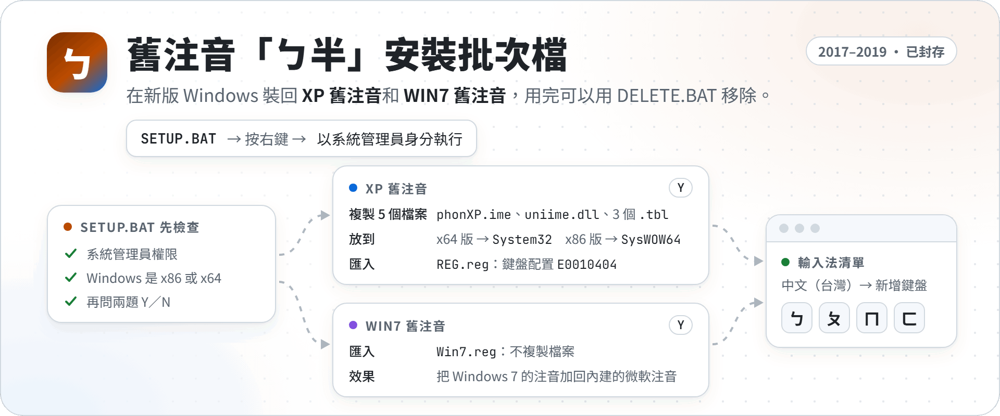
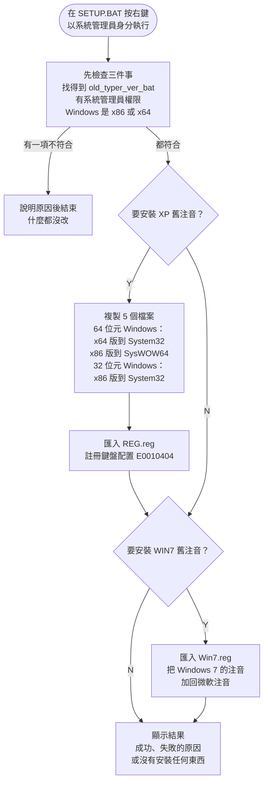

> [!TIP]
> **想要用回「ㄅ半」的話，我推薦 [琦琦輸入法（KeyKey）](https://github.com/polobread/KeyKey)，它才是最終的解法。**
> 它是 Yahoo! KeyKey（Yahoo! 奇摩輸入法）開放原始碼後的現代化版本，作者就是因為懷念微軟的「ㄅ半」才做的。
> Windows 版是原生的 TSF 輸入法（TSF 是 Windows 的輸入法框架），另外也有 macOS、Linux、iOS 和 Android 版，不用再把 XP 的檔案塞進系統資料夾。
>
> 我自己現在用的是[小狼毫（Weasel）](https://github.com/rime/weasel)，也就是 [RIME 中州韻輸入法引擎](https://rime.im/)的 Windows 版，用起來也覺得不錯。
>
> 這個 repo 已經封存，不再維護。

<p align="center">
  <picture>
    <source media="(prefers-color-scheme: dark)" srcset="https://raw.githubusercontent.com/NatLee/xp-and-win7-chinese-ime/master/docs/images/hero-dark.png">
    
  </picture>
</p>

<p align="center">
  <a href="https://github.com/NatLee/xp-and-win7-chinese-ime/actions/workflows/test.yml"></a>
  
  
</p>

Windows 8 之後，注音輸入法只剩新的「微軟注音」，大家習慣的「ㄅ半」（每個字自己選字的傳統注音）被藏了起來。我在 2017 年寫了這兩支批次檔把它裝回來：`SETUP.BAT` 安裝、`DELETE.BAT` 移除。

可以裝的有兩種，可以只裝一種，也可以兩種都裝：

- **XP 舊注音**：Windows XP 的注音輸入法。會把輸入法檔案複製到系統資料夾，再用登錄檔註冊成一個鍵盤配置，名稱是「Chinese (Traditional) - XP Phonetic」。
- **WIN7 舊注音**：Windows 7 的注音。不複製任何檔案，只匯入登錄檔，把「Chinese (Traditional) - Phonetic」加回系統內建的微軟注音。

## 安裝前先看：風險

- **要系統管理員權限。** 腳本會把檔案寫進 `C:\Windows\System32` 和 `C:\Windows\SysWOW64`，也會改 `HKEY_LOCAL_MACHINE` 的登錄檔。
- **請先建立系統還原點。** 開始功能表搜尋「建立還原點」，在「系統保護」分頁按「建立」。出問題時可以整台還原回去。
- **這些是很舊的 Microsoft 檔案。** XP 舊注音用的是 Windows XP SP2（32 位元）和 Windows Server 2003 SP2（64 位元）的檔案，2004–2007 年的版本，沒有數位簽章，也不會再有更新。
- **2026 年翻新時沒有在 Windows 10／11 上實際打字測試。** 安裝和移除流程有在 GitHub Actions 的 Windows Server 2025 上自動測試，但那台機器沒有桌面可以打字，詳見下方「怎麼測試的」。
- 只支援 x86 和 x64 的 Windows。ARM64 的 Windows 會直接停下來，什麼都不改。

## 安裝

1. 下載：按 GitHub 頁面上的 **Code → Download ZIP**，然後**把整個 ZIP 解壓縮**。
   直接在 ZIP 裡面點兩下 `SETUP.BAT` 會找不到旁邊的 `old_typer_ver_bat` 資料夾。
2. 在解壓縮後的 `SETUP.BAT` 上按右鍵，選「**以系統管理員身分執行**」。
3. 依照畫面回答兩題，按一下 `Y`（是）或 `N`（否）就好，不用按 Enter：

   ```text
   要安裝 XP 舊注音嗎？ [Y,N]?Y
   要安裝 WIN7 舊注音嗎？ [Y,N]?Y
   ```

4. 看到「安裝成功」後，到輸入法設定把它加進來：
   - Windows 10／11：**設定 → 時間與語言 → 語言（與地區）→ 中文（台灣）→ 語言選項 → 新增鍵盤**。
   - WIN7 舊注音會是清單裡另一個「微軟注音」；XP 舊注音在登錄檔裡的名稱是「Chinese (Traditional) - XP Phonetic」。新版 Windows 的清單不一定會列出 XP 舊注音，這部分 2026 年翻新時沒有重新確認。
5. 如果加不進來或打不出字，先重開機再試一次。

### 安裝時做了哪些事



如果是從 32 位元的命令列（例如 32 位元的檔案管理員）啟動，腳本會先改用 64 位元的命令列重新執行。不然 Windows 會把 `System32` 自動導到 `SysWOW64`，檔案和登錄檔都會放錯地方。

## 移除

1. 先到輸入法設定，把舊注音從鍵盤清單拿掉。`DELETE.BAT` 只刪系統資料夾和 `HKEY_LOCAL_MACHINE` 的東西，不會動你自己帳號裡的輸入法清單。
2. 在 `DELETE.BAT` 上按右鍵，選「以系統管理員身分執行」，按 `Y`。
3. 如果畫面說「有檔案正在使用中，刪不掉」，重開機後再執行一次 `DELETE.BAT`。登錄檔第一次就會刪掉，重開機後 Windows 就不會再載入舊注音，檔案也就刪得掉了。

`DELETE.BAT` 要刪的檔案和登錄機碼，是從 `old_typer_ver_bat` 裡的檔案名稱和 `.reg` 檔推出來的，所以只會刪 `SETUP.BAT` 裝的東西。什麼都沒裝的時候執行，它會說「沒有找到已安裝的舊注音」。

## 會改到哪些地方

| 項目 | 位置 |
|---|---|
| XP 舊注音的檔案 | `C:\Windows\System32` 和 `C:\Windows\SysWOW64` 裡的 `phonXP.ime`、`uniime.dll`、`phon.tbl`、`phoncode.tbl`、`phonptr.tbl` |
| XP 舊注音的鍵盤配置 | `HKLM\SYSTEM\CurrentControlSet\Control\Keyboard Layouts\E0010404` |
| WIN7 舊注音的設定檔 | `HKLM\SOFTWARE\Microsoft\CTF\TIP\{B115690A-EA02-48D5-A231-E3578D2FDF80}\LanguageProfile\0x00000404\{761309DE-317A-11D4-9B5D-0080C882687E}` |

## 檔案結構

```text
SETUP.BAT              安裝
DELETE.BAT             移除
old_typer_ver_bat/
  REG.reg              XP 舊注音的鍵盤配置
  Win7.reg             WIN7 舊注音的設定檔（UTF-16 編碼）
  System32/            64 位元的輸入法檔案（Windows Server 2003 SP2 x64）
  SysWOW64/            32 位元的輸入法檔案（Windows XP SP2）
tests/                 GitHub Actions 跑的檢查
docs/images/           README 的封面圖，原始檔在 src/hero.html
```

`old_typer_ver_bat` 底下的資料夾名稱，是照「在 64 位元 Windows 上要放去哪裡」命名的。所以 `System32` 資料夾裡放的是 64 位元版，`SysWOW64` 放的是 32 位元版。在 32 位元 Windows 上，32 位元版會放進 `System32`。

兩支批次檔是 Big5 編碼、CRLF 換行，`.gitattributes` 會確保下載或 clone 下來都是 CRLF。LF 換行的批次檔，有時候會讓 cmd 找不到 `goto` 的標籤。

## 怎麼測試的

每次 push 和 PR，[GitHub Actions](https://github.com/NatLee/xp-and-win7-chinese-ime/actions/workflows/test.yml) 會開一台用完就丟的 Windows Server 2025，跑兩支腳本：

- `tests/check-files.ps1`：只讀檔案，在自己的電腦上跑也安全。檢查換行、Big5 編碼、`.reg` 的格式和機碼，以及 `System32`／`SysWOW64` 資料夾裡的檔案真的是 64／32 位元版。

  ```powershell
  powershell -NoProfile -ExecutionPolicy Bypass -File tests\check-files.ps1
  ```

- `tests/install-uninstall.ps1`：真的執行 `SETUP.BAT` 和 `DELETE.BAT`，每次執行後檢查系統資料夾和登錄檔。因為會改系統，它只肯在 GitHub Actions 上跑。測試的情況包括：路徑有空白和括號、一般使用者執行、只裝一種、兩種都裝、重複安裝、重複移除、從 32 位元命令列啟動、模擬 32 位元 Windows、模擬 ARM64，以及檔案正在使用中。它也確認 32 位元程式讀得到 WIN7 舊注音的登錄機碼。

沒辦法自動測的：在 Windows 10／11 桌面版實際切換輸入法、打字。

## 已知問題

- Windows 7 本來就內建 WIN7 舊注音，不需要安裝。在 Windows 7 上執行 `DELETE.BAT`，可能會連系統內建的那份一起刪掉（推論，沒有在 Windows 7 上確認）。
- `DELETE.BAT` 不會清你帳號裡的輸入法清單，所以請照「移除」第 1 步先自己拿掉。

## 檔案的著作權

`old_typer_ver_bat/System32` 和 `old_typer_ver_bat/SysWOW64` 裡的 `phonXP.ime`、`uniime.dll` 和 3 個 `.tbl`，是 Windows XP SP2 和 Windows Server 2003 SP2 的 Microsoft 檔案，著作權屬於 Microsoft。放在這裡只是為了保存，讓還想用「ㄅ半」的人裝得回來。我寫的部分只有兩支批次檔、測試和說明。如果你在意授權，請改用最上面推薦的琦琦輸入法，它是開放原始碼的。

## 狀態

這個 repo 已經封存，不再維護，也不再處理 issue 和 PR。要用「ㄅ半」，請看最上面推薦的琦琦輸入法。

[Releases](https://github.com/NatLee/xp-and-win7-chinese-ime/releases) 裡的「舊注音安裝」（`1.0`）是 2017 年打包的舊版，沒有 2026 年的修正。如果還是要用這個 repo，請改用 GitHub 的「Code → Download ZIP」下載最新版。

*By Nat Lee*
